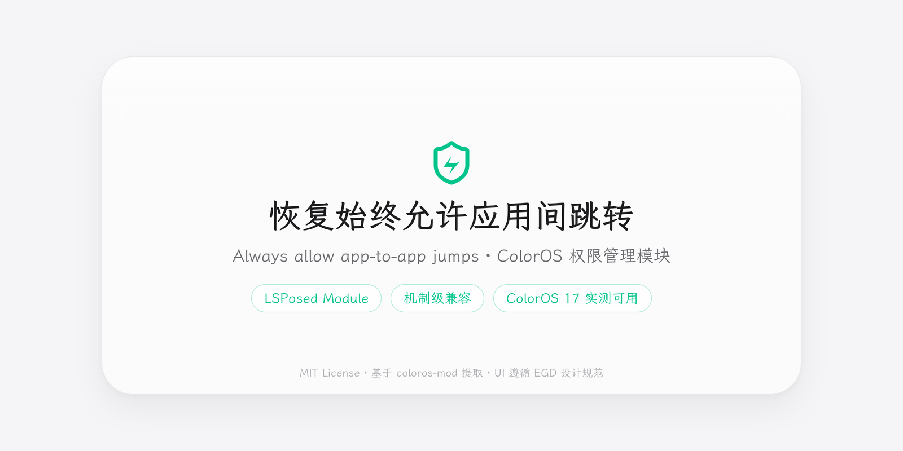

# Always Allow App-to-App Jumps · AppStartConfirm

> Restores the native **「Always allow to open」** checkbox on the app-jump confirmation dialog in ColorOS permission manager.
> A standalone LSPosed module extracted from [coloros-mod](https://github.com/rikumi/coloros-mod) (MIT).



**Mechanism-level compatibility** · no version whitelist · verified on **ColorOS 17 / Android 17**
(logic baseline: SecurityPermission 16.08.003 on Android 16, decompiled and verified)

---

## Features

- **Restores the native "Always allow to open" checkbox**: the new dialog (`activity_start_confirm_version=2`) only offers "Allow for 30 days". This module rewrites the Intent version back to 0 before `AppStartConfirmDialogActivity#onCreate`, making the system use the legacy dialog with the "Always allow to open" checkbox
- **Single hook point**: no click-callback patching, no direct grant API calls; payment protection, mini-program interception, blacklist and game-pay interception keep their native paths
- **Cross-process settings**: ContentProvider (Binder) + DE storage + ContentObserver push — the toggle takes effect on the next jump without a reboot
- **Hide launcher icon**: optional one-tap hiding of the launcher entry; the restore entry stays in the LSPosed module list
- **EGD-styled settings page**: liquid glass + LXGW WenKai + signature green, dark/light themes follow the system
- **Zero bloat dependencies**: pure Java, no Kotlin/Compose/miuix, no androidx — APK ≈ 360 KB

## Install & Use

1. Install **LSPosed 2.x** (libxposed API 102) or another compatible framework
2. Install the APK and enable the module in LSPosed
3. **Check scope "Permission manager" (`com.oplus.securitypermission`)** and reboot
4. Open the module (launcher icon or LSPosed entry) and turn the toggle on
5. Trigger a jump between a not-yet-authorized pair of apps — the dialog should show the "Always allow to open" checkbox; checking it saves a long-term grant

> The scope list may display the app as "Permission manager"; the package name is `com.oplus.securitypermission`.

## Compatibility

- Mechanism is **independent of the system version** (no version whitelist in code): works as long as the system keeps the `AppStartConfirmDialogActivity` class and the `version 2 → legacy dialog` branch
- Verified on: **ColorOS 17 / Android 17** (2026-10)
- Logic baseline: SecurityPermission `16.08.003` (SHA256 `a07868b7dbbfb3af9bea64f3488f8a3fe847ac0aec639f0ac0f51c01b0bd9c22`)
- If a later system version changes the class or branch, the hook only logs `HOOK FAIL` and leaves the system untouched
- Modding has risks — back up first

## Build

Requires JDK 17+, Android SDK (platform 37), access to Google Maven / Maven Central.

Pinned toolchain: AGP `8.9.2` + Gradle `8.13` + `compileSdk 37`.

```bash
export ANDROID_HOME=/path/to/android-sdk
./gradlew :app:assembleDebug
# Output: app/build/outputs/apk/debug/app-debug.apk
```

Default debug signing is installable out of the box; for a stable signature see `signing.properties.example`.

## Verification

```bash
python3 scripts/check-app-start-confirm.py
```

788 JVM-stub checks: default-off, toggle, version boundaries, risky start_type boundaries, Intent copies, hook registration target, scope wiring, string resources.

## How it works

The new app-jump confirm dialog in ColorOS permission manager (`activity_start_confirm_version=2`) dropped the "Always allow to open" checkbox. Before `com.oplusos.securitypermission.permission.ui.AppStartConfirmDialogActivity#onCreate` this module:

1. reads the module toggle (cross-process);
2. when enabled, action is `oplus.app.action.CHECK_ALLOW_START_ACTIVITY`, version is 2 and `start_type ∈ {0, 5, 6}`, rewrites the Intent copy's version to 0;
3. native `version != 2` path renders the legacy dialog (with the "Always allow to open" checkbox);
4. checking and allowing saves a permanent grant (native `ALWAYS_ALLOW_START=101`).

## Layout

```
app/
└── src/main/
    ├── AndroidManifest.xml            # entry Activity + settings Provider (directBootAware)
    ├── java/io.github.kepsilent.appstartconfirm/
    │   ├── XposedInit.java            # libxposed entry + cross-process settings reader
    │   ├── SettingsProvider.java      # settings over Binder (bypasses SELinux)
    │   ├── MainActivity.java          # EGD-styled settings page (toggle + hide icon)
    │   ├── hooks/AppStartConfirmHooks.java  # the only hook
    │   └── xposed/                    # legacy Xposed API compatibility layer
    ├── resources/META-INF/xposed/     # java_init.list / module.prop / scope.list
    ├── assets/fonts/                  # LXGW WenKai (OFL 1.1, subset)
    └── res/                           # EGD theme (dark/light) + strings (zh/en) + icon
scripts/check-app-start-confirm.py
docs/banner.png
```

## License

- Hook logic & settings channel derived from [rikumi/coloros-mod](https://github.com/rikumi/coloros-mod), **MIT License**
- Font LXGW WenKai, **SIL OFL 1.1** (subset shipped in APK; license under `assets/licenses/`)
- Icon is a personal redraw of the OPPO Phone Manager style, flipped (personal artwork, not official material)
- Settings UI follows the [EGD (Elegant Geek Design)](https://github.com/Kepsilent/Elegant-Geek-Design) design system
